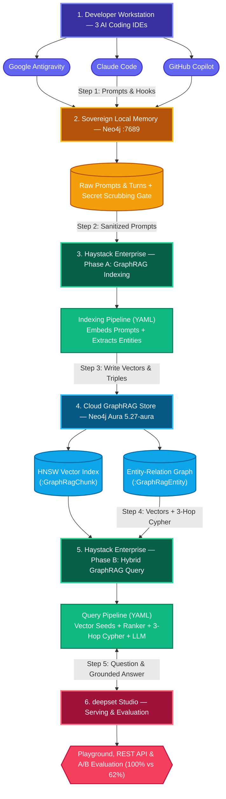

# Haystack + Neo4j Workshop — Final Challenge Results & Architecture Guide

End-to-end engineering results for **deepset Haystack (2.x / 3.x)** and **Neo4j**, organized in progressive order from foundational pipelines (**Challenges 01–06**), to custom Neo4j document stores and hybrid GraphRAG (**Challenges 07–11**), to cross-agent long-term graph memory across **Claude Code**, **Google Antigravity**, **Gemini CLI**, and **GitHub Copilot CLI** (**Challenges 12–15**).



### Architecture Explanation & Execution Order (Step 1 → Step 6)

All user prompts, coding turns, and architectural learnings from the 3 AI coding IDEs are captured, scrubbed of secrets, and **indexed into Neo4j Aura GraphRAG via Haystack Enterprise Platform**:

1. **Step 1 — Capture Prompts & Sessions (`Tier 1` → `Tier 2`)**: Developers work in **Claude Code**, **Google Antigravity**, and **GitHub Copilot CLI**. Lifecycle hooks (`log_event.py`, `mkg_agent_hook.py`) and the 13-tool MKG MCP server record every user prompt, turn, tool call, and learning into the local sovereign Neo4j database (`:7689`).
2. **Step 2 — Secret Scrubbing & Ingestion into Haystack Enterprise (`Tier 2` → `Tier 3`)**: `scrub_secrets.py` strips `.env` keys and tokens from all prompts. **Haystack Enterprise comes into place first (Phase A — Ingestion)**: sanitized prompts and approved learnings are fed into the **Haystack Enterprise GraphRAG Indexing Pipeline** (`enterprise_graphrag_index.yaml`).
3. **Step 3 — Store Prompts & Triples in Cloud GraphRAG (`Tier 3` → `Tier 4`)**: The Haystack Enterprise Indexing Pipeline embeds every prompt/learning (`SentenceTransformersDocumentEmbedder`) and extracts `(Entity)-[REL]->(Entity)` triples (`LLMGraphExtractor` + `Neo4jGraphWriter`), writing both `(:GraphRagChunk)` HNSW vectors and `(:GraphRagEntity)` nodes into **Neo4j Aura (`5.27-aura`)**.
4. **Step 4 — Ask a Multi-Hop Question (`Tier 5` → `Tier 3`)**: **Haystack Enterprise comes into place second (Phase B — Query & Evaluation)**: an engineer or agent submits a cross-IDE question in **deepset Studio Playground** or via REST API to the **Hybrid GraphRAG Query Pipeline** (`enterprise_graphrag_query.yaml`).
5. **Step 5 — Hybrid Vector + 3-Hop Cypher Retrieval (`Tier 3` ↔ `Tier 4`)**: Haystack Enterprise retrieves top-K vector seed chunks from Aura, reranks them with a cross-encoder, and runs `Neo4jGraphRetriever` (`<= 3 hops`, hub-pruned) across the entity graph to connect facts across all stored prompts and IDEs.
6. **Step 6 — Grounded Synthesis & A/B Evaluation (`Tier 3` → `Tier 5`)**: `ChatPromptBuilder` + `LLM` generates a grounded answer with provenance and logs A/B evaluation metrics (`100%` GraphRAG multi-hop recall vs. `62%` vector-only) in **deepset Studio**.

---

## 1. Challenge Progression & Final Results (01 → 15)

### Stage 1: Core Haystack 2.x / 3.x Foundations (`exercises/01`–`06`)

| # | Challenge | File | Key Components & Pattern | Final Result |
|---|---|---|---|---|
| **01** | **Basic RAG Pipeline** | [`01_basic_pipeline.py`](exercises/01_basic_pipeline.py) | `InMemoryBM25Retriever` → `ChatPromptBuilder` → `ChatGenerator` | Declarative `Pipeline` composition with typed connections |
| **02** | **Dense Embedding RAG** | [`02_rag_with_embeddings.py`](exercises/02_rag_with_embeddings.py) | `SentenceTransformersDocumentEmbedder` + `TextEmbedder` + `InMemoryEmbeddingRetriever` | Separate index & query pipelines with dense cosine retrieval |
| **03** | **Custom Component** | [`03_custom_component.py`](exercises/03_custom_component.py) | `@component` decorator + `@component.output_types` | Custom typed component integrated into a Haystack pipeline |
| **04** | **Multi-Step Tool Agent** *(Challenge B)* | [`04_agent_tool_use.py`](exercises/04_agent_tool_use.py) | Haystack `Agent` + `Tool` (JSON schema function calling) | Multi-step tool execution loop replacing legacy 1.x agents |
| **05** | **Hybrid Retrieval + RRF** *(Challenge A)* | [`05_hybrid_retrieval.py`](exercises/05_hybrid_retrieval.py) | BM25 + Dense Vector → `DocumentJoiner(join_mode="reciprocal_rank_fusion")` | Combined lexical + semantic retrieval in one DAG |
| **06** | **Streaming Chat** *(Challenge C)* | [`06_streaming_chat.py`](exercises/06_streaming_chat.py) | `ChatMessage` history + `streaming_callback` | Real-time token streaming with multi-turn context |

---

### Stage 2: Haystack + Neo4j — Custom DocumentStore, Vector RAG & GraphRAG (`exercises/07`–`10`)

| # | Challenge | File | Architecture | Final Result |
|---|---|---|---|---|
| **07** | **Custom Neo4j DocumentStore** *(Challenge F)* | [`07_neo4j_document_store.py`](exercises/07_neo4j_document_store.py)<br>[`neo4j_document_store.py`](exercises/neo4j_document_store.py) | Implements Haystack `DocumentStore` protocol on Neo4j (`write`, `delete`, `count`, nested metadata filters → Cypher, native HNSW vector index) | **Passes Haystack's official `DocumentStoreBaseTests` conformance suite** ([`test_neo4j_document_store.py`](exercises/test_neo4j_document_store.py)) |
| **08** | **Neo4j Vector RAG + Reranker** *(Challenge A/F)* | [`08_neo4j_vector_rag.py`](exercises/08_neo4j_vector_rag.py)<br>[`neo4j_embedding_retriever.py`](exercises/neo4j_embedding_retriever.py) | Query embedder → `Neo4jEmbeddingRetriever` (top-10) → cross-encoder `TransformersSimilarityRanker` (top-4) → LLM | **100% accuracy on single-hop questions** (~195 context tokens/query); safely answers *"I don't know"* on out-of-domain queries |
| **09** | **Hybrid GraphRAG on Neo4j** *(Challenge B)* | [`09_graphrag.py`](exercises/09_graphrag.py)<br>[`neo4j_graph.py`](exercises/neo4j_graph.py) | Indexing: `LLMGraphExtractor` + `Neo4jGraphWriter` (`(:GraphRagChunk)-[:MENTIONS]->(:GraphRagEntity)-[:REL]->(:GraphRagEntity)`). Query: Vector seeds + entity linking + `Neo4jGraphRetriever` ($\le 3$ hops, hub-pruned) | Resolves multi-hop relational chains (`LED_BY → REPORTS_TO → WORKS_FROM`) that vector similarity misses ([`GRAPHRAG.md`](exercises/GRAPHRAG.md)) |
| **10** | **A/B Evaluation: Vector RAG vs. GraphRAG** *(Challenge D)* | [`10_eval_rag_vs_graphrag.py`](exercises/10_eval_rag_vs_graphrag.py)<br>[`graphrag_pipelines.py`](exercises/graphrag_pipelines.py) | 22 questions (8 single-hop, 14 multi-hop) $\times$ 3 runs with Azure OpenAI `gpt-5-mini` as generator and judge | **Vector RAG: 62%** (100% single-hop, 40% multi-hop)<br>**Vector $k=8$: 68%** (100% single-hop, 50% multi-hop)<br>**Hybrid GraphRAG: 100%** (100% single-hop, **100% multi-hop**) |
| **11** | **Haystack Enterprise Platform + Neo4j Aura Bundle** *(Challenge E/G)* | [`12_enterprise_aura_bundle.py`](exercises/12_enterprise_aura_bundle.py)<br>[`neo4j_graph.py`](exercises/neo4j_graph.py) | `to_dict()` / `from_dict()` serialization across all Neo4j GraphRAG components, YAML `dumps()`/`loads()` round-trip verification, secret-safety audit, and Custom Component ZIP packager | Exports `build/enterprise_graphrag_index.yaml`, `build/enterprise_graphrag_query.yaml` (`neo4j+s://...`), and `build/neo4j_haystack_enterprise_components.zip` for `/api/v2/custom_components` |

---

### Stage 3: Neo4j Graph Memory for AI Agents (`exercises/11` & `claude_memory/`)

| # | Challenge | File | Architecture | Final Result |
|---|---|---|---|---|
| **12** | **Haystack Agent with Neo4j Fact Memory** *(Challenge C)* | [`11_neo4j_memory_agent.py`](exercises/11_neo4j_memory_agent.py)<br>[`neo4j_memory.py`](exercises/neo4j_memory.py) | Haystack `Agent` with `remember`, `recall`, and `forget` tools backed by Neo4j (`valid_to` temporal fact retirement + disconnected subgraph pruning + loop guard) | **11 / 11 unit tests passing** ([`test_neo4j_memory.py`](exercises/test_neo4j_memory.py)); preserves historical audit trail via `recall(history=True)` |
| **13** | **Agent Memory Interface Benchmark: MCP vs. CLI vs. HTTP API** | [`claude_memory/bench.py`](claude_memory/bench.py)<br>[`mcp_server.py`](claude_memory/mcp_server.py), [`cli.py`](claude_memory/cli.py), [`api.py`](claude_memory/api.py) | Headless Claude Code (`claude -p`) stores 5 facts, recalls them in a fresh session, and updates a city across 3 interfaces $\times$ 3 repetitions | **MCP wins: 3/3 (100%) pass under narrow permissions at ~23.7K tokens (\$0.024, 23s)** vs. CLI (1/3 narrow, 47K tokens, 45s) and HTTP API (0/3 narrow, 39K tokens) |
| **14** | **Cross-Agent Long-Term Graph Memory & Provenance Audit** | [`claude_memory/`](claude_memory/README.md)<br>[`SOLUTION.md`](SOLUTION.md) | Neo4j (`:7689`, APOC + GDS) + `meta-knowledge-graph` (MKG) + [`recall_all.py`](claude_memory/recall_all.py) + [`mkg_agent_hook.py`](claude_memory/mkg_agent_hook.py) + [`prompt_evidence.py`](claude_memory/prompt_evidence.py) + [`scrub_secrets.py`](claude_memory/scrub_secrets.py) | - **Recall Eval**: **10/10** ground-truth questions passed (`memory_eval.py`)<br>- **Prompt Audit**: **51/51** transcripts verified (`prompt_audit.py`, Q13) + 85-prompt evidence chain (Q14)<br>- **Cross-Agent Codeword (`BLUE-HERON-42`)**: Stored by **Google Antigravity** via MCP, recalled by **Claude Code** (`e1a5a822`), and hook-injected into **GitHub Copilot CLI** (`89f97e2e`) |
| **15** | **Sovereign 3-IDE Collective Memory & Auditable Decision Provenance on Haystack Enterprise + Neo4j Aura** *(Challenge H — Hackathon Flagship)* | [`13_enterprise_aura_multi_ide.py`](exercises/13_enterprise_aura_multi_ide.py)<br>[`ENTERPRISE_HACKATHON.md`](exercises/ENTERPRISE_HACKATHON.md) | Promotes approved, secret-scrubbed learnings, architectural decisions (`DEC-01`–`DEC-03`), team member attribution, tools used, and data artifacts from **Claude Code**, **Google Antigravity**, and **GitHub Copilot** into **Neo4j Aura (`5.27-aura`)** and serves explainable audits via **Haystack Enterprise Platform** Hybrid GraphRAG | **4 / 4 (100%) multi-hop & decision-audit questions passed** (23 entities, 34 relations) on live Neo4j Aura (`neo4j+s://ma3u-g993-fhgd.endpoints.neo4j.io`); exports Studio eval set `build/enterprise_multi_ide_eval.json` |

---

## 2. Decision Guide: When to Use Haystack vs. When to Use Neo4j

Haystack and Neo4j operate at different layers of the AI stack:
- **Haystack** is a **stateless pipeline and agent orchestration framework** (how data and prompts flow between models and components).
- **Neo4j** is a **stateful graph + vector database** (how documents, embeddings, entities, relationships, and session histories are connected and queried).

### When to Use Haystack
Use **Haystack** when building **application-level LLM pipelines** that require:
1. **Composable Ingestion & Retrieval DAGs**: Connecting PDF/Markdown converters, splitters, embedders, rankers, and generators with compile-time type checking (`Pipeline.connect()`).
2. **Controlled A/B Evaluation**: Comparing retrieval strategies (BM25 vs. Vector vs. GraphRAG) using identical prompts, rankers, and LLM judges ([`graphrag_pipelines.py`](exercises/graphrag_pipelines.py), [`10_eval_rag_vs_graphrag.py`](exercises/10_eval_rag_vs_graphrag.py)).
3. **LLM Provider Portability**: Switching between Azure OpenAI, OpenAI, Google Gemini, or offline mocks in one factory ([`exercises/llm.py`](exercises/llm.py)).
4. **Production Pipeline Serialization**: Exporting pipelines to YAML (`pipeline.dumps()`) and serving them via Hayhooks/FastAPI on Kubernetes.

**When NOT to use Haystack:**
- **IDE Lifecycle Hooks & Lightweight CLI Adapters**: In Challenge 13 (`claude_memory/`), hooks fire on every prompt and tool call. Importing a full orchestration framework adds multi-second cold-start latency; direct Python + the `neo4j` driver and REST embedding calls ([`recall_all.py`](claude_memory/recall_all.py) runs in ~0.8s) is the right tool.

### When to Use Neo4j
Use **Neo4j** when your problem depends on **multi-hop relationships, provenance chains, or shared state**:
1. **Multi-Hop Reasoning (GraphRAG)**: When answering a question requires chaining facts across separate documents (*"In which office does the manager of Project Halcyon's lead work?"*). Vector similarity alone achieved only **40%–50%** on multi-hop questions; adding Neo4j Cypher traversal (`LED_BY → REPORTS_TO → WORKS_FROM`) reached **100%**.
2. **Unified Vector + Graph Storage**: Keeping text chunks, HNSW vector indexes, and entity-relationship subgraphs in **one database** (`Neo4jDocumentStore` + `Neo4jGraphWriter`), eliminating dual-database sync.
3. **Temporal & Auditable Agent Memory**: Tracking when facts were learned or retired (`valid_to` in [`neo4j_memory.py`](exercises/neo4j_memory.py)) or querying full execution provenance (`(:User)-[:HAS_SESSION]->(:Session)-[:HAS_EVENT]->(:SessionEvent)` and `(:Turn)-[:ISSUED]->(:ToolCall)-[:TARGETS]->(:Resource)` in Q1–Q14).
4. **Cross-Agent Long-Term Memory**: Sharing durable project learnings and episodic observations across **Claude Code**, **Google Antigravity**, **Gemini CLI**, and **GitHub Copilot CLI** beyond Claude's 30-day local JSONL retention window.

**When NOT to use Neo4j (or GraphRAG):**
- **Single-Hop FAQ / Document Lookup**: Both Vector RAG and GraphRAG scored **100%** on single-hop questions, but GraphRAG used **4× more prompt tokens** (777 vs. 195) and required an LLM extraction call per chunk at ingest. Use standard Vector RAG + a cross-encoder reranker for single-hop workloads.
- **Single-Agent Short-Term Coding Context**: If one developer uses one coding agent and only needs session resumption and static project conventions, native JSONL transcripts (`/resume`) plus a curated `CLAUDE.md` / `AGENTS.md` have zero per-prompt hook overhead, zero LLM extraction cost, and no secondary database holding sensitive tool outputs.

### Summary Decision Matrix

| Workload | Use Haystack? | Use Neo4j? | Recommended Pattern |
|---|---|---|---|
| **Single-hop document / FAQ Q&A** | **Yes** | Optional (any vector DB) | **Haystack Vector/Hybrid RAG + Reranker** (Challenges 05, 08) |
| **Multi-hop Q&A over connected entities** | **Yes** | **Yes** | **Haystack + Neo4j Hybrid GraphRAG** (Challenges 09, 10) |
| **Custom application agent with user/fact memory** | **Yes** | **Yes** | **Haystack `Agent` + `Neo4jMemory` Tools** (Challenge 11) |
| **Cross-IDE coding agent memory** (Claude, Antigravity, Gemini, Copilot) | **No** | **Yes** | **Neo4j + MCP Server + Lightweight Hooks** (Challenges 12, 13) |
| **Single-agent local project instructions** | **No** | **No** | **Curated `CLAUDE.md` / `AGENTS.md` + native `/resume`** |

---

## 3. Quick Start & Verification Commands

```bash
python3 -m venv venv
source venv/bin/activate
pip install -r requirements.txt
cp .env.example .env
```

```bash
# Challenges 07 & 11: Run Neo4j DocumentStore & Neo4jMemory conformance/unit tests
pytest exercises/test_neo4j_document_store.py exercises/test_neo4j_memory.py

# Challenges 09 & 10: Build the GraphRAG graph and run the 3-variant accuracy benchmark
python exercises/09_graphrag.py --reset
python exercises/10_eval_rag_vs_graphrag.py --runs 3

# Challenge 13: Run the 10-question agent memory evaluation, prompt audit, and evidence chain
uv run --script claude_memory/memory_eval.py
uv run --script claude_memory/prompt_audit.py --exclude 24ebda85 --show-missing
uv run --no-project --with mcp --with neo4j python claude_memory/prompt_evidence.py
```

## Documentation Index
- **[`SOLUTION.md`](SOLUTION.md)**: Full architectural evaluation, Haystack Enterprise analysis, speed/security trade-offs of native history vs. Neo4j graph memory, and cross-agent test report.
- **[`exercises/GRAPHRAG.md`](exercises/GRAPHRAG.md)**: Detailed comparison of Vector RAG vs. GraphRAG on Neo4j (`exercises/07`–`10`).
- **[`claude_memory/README.md`](claude_memory/README.md)**: Complete documentation for Challenges 12 & 13 (MCP/CLI/API benchmark, MKG graph model, Q1–Q14 Cypher queries, recall evaluation, prompt audit, and cross-agent setup).
- **[`exercises/README.md`](exercises/README.md)** & **[`exercises/CHALLENGES.md`](exercises/CHALLENGES.md)**: Exercise runner guide and original hackathon challenge prompts.
