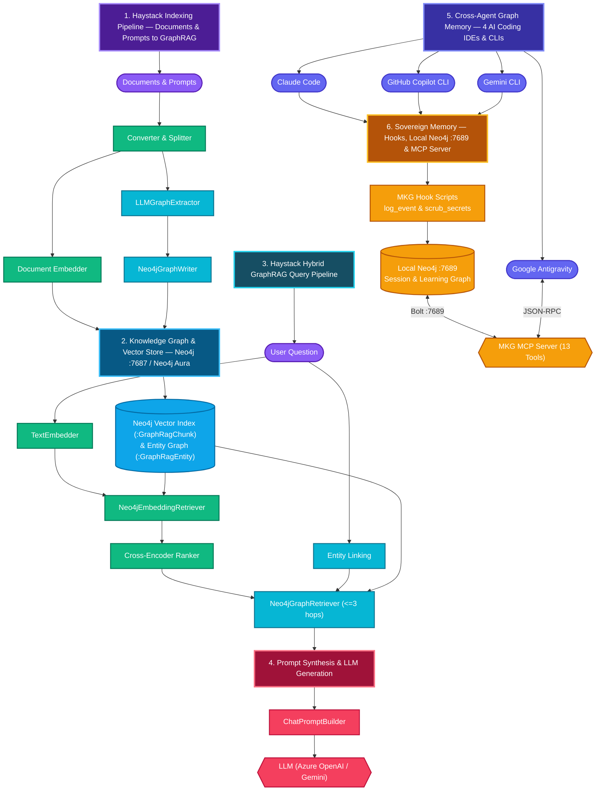

# Solution: Haystack + Neo4j, and graph memory for coding agents

State on 2026-10-20. This page sums up what the workshop built, what we measured, and where it falls short.
Details live in [exercises/GRAPHRAG.md](exercises/GRAPHRAG.md) and [claude_memory/README.md](claude_memory/README.md).

The repository holds two separate things that share one technology (Neo4j):

1. **Haystack on Neo4j**: a Neo4j `DocumentStore`, vector RAG, GraphRAG, an evaluation, and an agent with graph
   memory (`exercises/07`–`11`).
2. **Graph memory for coding agents**: every Claude Code session (and now Gemini CLI and GitHub Copilot CLI) is
   logged into a Neo4j graph by the meta-knowledge-graph (MKG) plugin. Learnings are extracted from it and
   recalled in later sessions (`claude_memory/`).

Part 2 does **not** use Haystack. MKG is its own Python package. Haystack appears in part 2 only in the first
experiment (`Neo4jMemory` behind MCP / CLI / HTTP, see the benchmark).

## 1. Architecture

Two Neo4j instances on purpose: workshop data (7687 / Neo4j Aura Cloud) and local sovereign agent memory (7689). The importer refuses to write memory into an instance that holds workshop labels.

### Diagram Explanation: Component Groups & Execution Order

- **Inputs**: User prompts, documents, and multi-hop questions entering the Haystack pipelines.
- **Haystack Vector & Ranking Components**: Standard Haystack components (`Converter & Splitter`, `SentenceTransformers Embedder`, `TextEmbedder`, `Neo4jEmbeddingRetriever`, `Cross-Encoder Ranker`) that chunk, embed, and rerank passages.
- **Haystack GraphRAG Components**: Our custom `@component` classes (`LLMGraphExtractor`, `Neo4jGraphWriter`, `Entity Linking`, `Neo4jGraphRetriever`) packaged into `build/neo4j_haystack_enterprise_components.zip` for **Haystack Enterprise Platform**.
- **Knowledge Graph & Vector Store**: **Neo4j (`:7687` or Neo4j Aura Cloud `5.27-aura`)** storing both 384-dim HNSW vector chunks (`:GraphRagChunk`) and entity-relationship triples (`:GraphRagEntity`).
- **Synthesis & LLM Generation**: `ChatPromptBuilder` and the `LLM` (`Azure OpenAI` / `Gemini`) that synthesize the final answer from reranked passages + multi-hop graph facts.
- **AI Coding IDEs & CLIs** & **Sovereign Memory, Hooks & MCP Server**: **Claude Code**, **Google Antigravity**, **GitHub Copilot CLI**, and **Gemini CLI** log all raw prompts and turns to local Neo4j (`:7689`) via hooks and MCP (`scrub_secrets.py` redacts credentials), after which sanitized prompts and learnings are indexed into **Neo4j Aura GraphRAG** via **Haystack Enterprise**.

## 2. Why Haystack

Haystack is an orchestration framework: typed components connected into pipelines. In this workshop it carried:

| Need | What Haystack gave us | Evidence in the repo |
|------|-----------------------|----------------------|
| Plug Neo4j in as a real store | The `DocumentStore` protocol and its conformance test suite | `neo4j_document_store.py` passes `DocumentStoreBaseTests` |
| Add GraphRAG without a new framework | Three plain `@component` classes | `LLMGraphExtractor`, `Neo4jGraphWriter`, `Neo4jGraphRetriever` in `neo4j_graph.py` |
| Fair A/B evaluation | One builder function makes all variants with the same prompt, ranker and LLM | `graphrag_pipelines.build_query`, `10_eval_rag_vs_graphrag.py` |
| Switch LLM providers | One factory | Moved from Gemini to Azure OpenAI by changing `llm.py` only |
| Agents with tools | `Agent` component with tool calling | `11_neo4j_memory_agent.py` |
| Path to production | Pipelines serialize to YAML; can be served with Hayhooks | Challenge E |

Honest limits we hit:

- **API churn.** `OpenAIGenerator` was removed and SentenceTransformers moved to a separate package between
  versions (see the Gotchas in `README.md`). Pin versions.
- **No Neo4j GraphRAG out of the box.** We wrote the store, the retriever and the three graph components ourselves
  (about 700 lines). The community `neo4j-haystack` integration covers the store and Cypher retrieval, not LLM graph
  extraction.
- **Agent loops.** `gpt-5-mini` in the Haystack `Agent` looped on `recall` until `max_agent_steps` in about half the
  runs. A prompt rule did not fix it; code in `neo4j_memory.py` blocks repeated calls.
- **The framework does not make retrieval good.** The 62 % → 100 % jump came from the graph, not from Haystack.
  Haystack made it cheap to build and measure.

## 3. Why Haystack and Neo4j work well together

Measured on 22 questions (8 single-hop, 14 multi-hop), `gpt-5-mini`, 3 runs each:

| Variant | Overall | Single-hop | Multi-hop | Avg context tokens |
|---------|---------|------------|-----------|--------------------|
| Vector RAG (top 10 → rerank top 4) | 62 % | 100 % | 40 % | 195 |
| Vector RAG (top 8, no rerank) | 68 % | 100 % | 50 % | 351 |
| GraphRAG (vector seeds + graph facts) | **100 %** | 100 % | **100 %** | 777 |

Why the combination works:

- **One database for chunks, embeddings and the entity graph.** The vector index finds the seed passages, Cypher
  walks `LED_BY → REPORTS_TO → WORKS_FROM` from there. No sync between a vector DB and a graph DB.
- **Hybrid is one `connect()`.** The ranker's documents feed the graph retriever; passages and facts both feed the
  prompt. The best variant is exactly this hybrid.
- **Multi-hop recall is the gap vector search cannot close.** Doubling the passages moved multi-hop only from 40 %
  to 50 %.

Be honest about the numbers:

- The corpus and the questions were written together to test multi-hop reasoning. This is not a neutral benchmark.
- GraphRAG settings (3 hops, 50 facts) were tuned on the same questions. There is no held-out set.
- The graph is tiny (about 100 entities): 50 facts are about half of it, so selectivity was never tested.
- GraphRAG costs about 4× the prompt tokens plus one LLM call per chunk at indexing, and entity normalization is
  manual work.
- On single-hop questions (FAQ, docs lookup) GraphRAG adds nothing. Use vector RAG there.

## 4. Haystack Enterprise

deepset sells **Haystack Enterprise** next to the open-source framework (launched August 2025) and the deepset
AI Platform. According to deepset's own pages it adds:

- **Support from the Haystack team**: consultation hours (from Kubernetes autoscaling to use-case design and
  custom components) and faster answers than the community channels.
- **Private templates**: production pipeline templates (lightweight RAG, agentic RAG, multimodal, multi-agent with
  MCP) in a private repository.
- **Deployment guides**: Helm charts and best-practice guides for Kubernetes on AWS, Azure, GCP or on-premise.
- **Platform option**: the deepset AI Platform runs in the cloud, in a VPC, on-premise or air-gapped.

How it would fit this solution:

| Part of this repo | Enterprise use |
|-------------------|----------------|
| GraphRAG pipelines | Start from the agentic-RAG template and keep our Neo4j components; ask the team to review the custom `DocumentStore` |
| Serving | Helm chart for Hayhooks on Kubernetes (Azure, next to the Azure OpenAI resource) |
| Agent memory | The multi-agent-with-MCP template is the closest match to the MKG MCP server |
| Evaluation | Run `10_eval_rag_vs_graphrag.py` in CI against the deployed pipelines |

Haystack Enterprise is a support and templates offer, not a different framework. Everything in this repo runs on
the open-source version. Buy it if a team needs production support or on-prem deployment help, not for features.
Pricing and the exact template list were not checked; ask deepset.

Sources: [Haystack Enterprise](https://www.deepset.ai/products-and-services/haystack-enterprise),
[launch post](https://www.deepset.ai/blog/introducing-haystack-enterprise),
[Kubernetes docs](https://haystack.deepset.ai/docs/kubernetes).

## 5. Agent memory: Claude's own history vs the graph memory

**Claude's own history:**
- transcripts in `~/.claude/projects/<project>/*.jsonl` (101 MB, 20 transcripts here), opened with `/resume`
- `CLAUDE.md` / `MEMORY.md` files loaded at session start

**Graph memory:** MKG logs every event into Neo4j, extracts `:Learning` / `:Observation` with an LLM, and serves
them through hooks and MCP.

### Speed (measured 2026-10-20 on this machine)

| Operation | Claude history | Graph memory |
|-----------|----------------|--------------|
| Find which transcripts mention `7689` | `grep`: 0.04 s, but returns files, not answers | Cypher over all events: 0.2 s |
| Answer "which port does the memory Neo4j use?" | Claude reads transcripts itself: many turns and tokens | `recall_all.py`: 0.7 s including the embedding call; correct hit at cosine 0.78-0.91 |
| Overhead per prompt | none | MKG `inject_project_context` hook: **5.3 s** (mostly loading `litellm`); adapter for Gemini/Copilot: 6-7 s |
| Overhead per tool call | none | `log_event` hook: about 0.4 s |
| Resume a session exactly | `/resume`: instant, lossless | not possible: the graph is not a transcript |

The graph answers faster than an agent that searches the transcripts, but every prompt pays a few seconds of hook
time. A long-running memory service would remove most of the 5 s, but MKG starts a new Python process per hook.

### Advantages and disadvantages

| | Claude history (native) | Graph memory (MKG + Neo4j) |
|---|---|---|
| **Setup** | + nothing to install | − Neo4j, APOC/GDS, credentials file, plugin, embedding and LLM deployment |
| **Completeness** | + verbatim, lossless | − 43/51 prompts at first; fixed to 51/51 with the audit. The importer truncates tool results to 4,000 characters and drops thinking blocks and images |
| **Long-term** | − transcripts are deleted after `cleanupPeriodDays` (default **30 days**). `MEMORY.md` lasts, but only what was written into it | + survives transcript cleanup; distilled learnings, an episode timeline and skills |
| **Recall quality** | − no ranking, no "no match"; the agent must grep | + vector + graph recall. MCP recall went 3/10 → 10/10 after fixes; `recall_all.py` 10/10 with a correct "no match". − before the fixes, ranking by status hid correct answers |
| **Structure** | − flat JSON lines | + Cypher over sessions, projects, tools and errors: error → fix paths, prompt → tool → file provenance (Q1-Q13) |
| **Cross-agent** | − Claude-only format. Plain Markdown (`AGENTS.md`, `CLAUDE.md`, `GEMINI.md`) is the simplest shared memory and every agent reads one of them | + one graph and one MCP server for Claude, Gemini and Copilot (section 6) |
| **Cross-machine / team** | − local files per machine | + a server can be shared (needs auth and network hardening) |
| **Security** | + one copy, local | − a second copy of everything, including secrets in tool output. On 2026-10-20 a Supabase token printed by a command reached the graph within seconds. `scrub_secrets.py` redacts after the fact; there is always a window |
| **Correctness** | + it is what happened | − learnings come from an LLM: facts get bundled, some are never extracted, the gate blocked a correct fact. Treat recall as a hint and verify |
| **Cost** | + free | − an LLM extraction per turn, embeddings, a running database |
| **Failure modes** | few | seen: an auth lockout (`AuthenticationRateLimit`) blocked every session, missing APOC hid the Cypher tools, an unlogged window before credentials existed, 19 task notifications stored as prompts |

**Verdict.** For one developer with one agent, Claude's own history plus a short, curated `MEMORY.md` / `AGENTS.md`
is faster, simpler and safer. The graph memory pays off when you need any of these:

- memory across several agents or machines
- memory older than 30 days
- questions over your whole working history ("which Neo4j errors did I hit, and how were they fixed?")

It costs setup, a few seconds per prompt, LLM spend and a second copy of sensitive data.

## 6. Cross-agent memory: Gemini CLI and GitHub Copilot CLI

MKG ships hooks for Claude Code (and Codex). `claude_memory/mkg_agent_hook.py` connects other agents without
changing MKG. It maps each agent's hook payload to the Claude Code shape and runs MKG's own scripts:

| Agent event | MKG event | What runs |
|-------------|-----------|-----------|
| Gemini `SessionStart`, Copilot `sessionStart` | `SessionStart` | `inject_project_context` (context returned to the agent), `log_event` |
| Gemini `BeforeAgent`, Copilot `userPromptSubmitted` | `UserPromptSubmit` | `inject_project_context`, fallback `recall_all.py`, `log_event` |
| Gemini `BeforeTool`/`AfterTool`, Copilot `preToolUse`/`postToolUse(Failure)` | `PreToolUse`/`PostToolUse` | `log_event` |
| Gemini `AfterAgent`, Copilot `agentStop` | `Stop` | `log_event`, `process_project --mode turn` (learning extraction, detached) |
| Gemini `SessionEnd`, Copilot `sessionEnd` | `SessionEnd` | `log_event`, `scrub_secrets.py --hook` (detached) |

Events are stored with `client = gemini_cli` / `copilot_cli`; everything else (sessions, projects, users, learnings)
is shared with Claude Code. Configuration (user level, like the Claude plugin):

| Agent | MCP server | Hooks |
|-------|-----------|-------|
| Google Antigravity | `mcpServers.meta-knowledge-graph` in `~/.gemini/antigravity/mcp_config.json` | Native MCP tools (`13` tools active in agent panel) |
| Gemini CLI | `mcpServers.meta-knowledge-graph` in `~/.gemini/settings.json` | `hooks` in `~/.gemini/settings.json` |
| Copilot CLI | `~/.copilot/mcp-config.json` | `~/.copilot/hooks/mkg.json` |

All MCP entries start MKG's own server: `bash <plugin>/scripts/mcp-launcher.sh <plugin>`, with
`MKG_ENV_FILE=~/.config/meta-knowledge-graph/.env`.

Copilot CLI also reads hooks from a repository's `.claude/settings.json` / `.claude/settings.local.json`. In this
repository the `recall_all.py --hook` prompt hook therefore runs for Copilot too; its output is ignored there,
because Copilot honors `additionalContext` only on `sessionStart`.

Test results (2026-10-20):

| Check | Google Antigravity | Gemini CLI 0.64.0 | Copilot CLI 1.0.100 | Claude Code |
|-------|--------------------|-------------------|---------------------|-------------|
| Adapter with the agent's payload format (synthetic events) | n/a (uses MCP directly) | pass: context returned, events logged | pass: context returned on `sessionStart`, tool events logged | pass (native plugin) |
| Real session logged by the hooks | n/a | blocked on personal Google subscription (CLI requires API/Vertex) | pass: sessions `8eebdefc`, `0fc6dc68`, `89f97e2e` logged as `copilot_cli` | pass: session `e1a5a822` logged as `claude_code` |
| MKG MCP server loads in the agent | **pass (`13` tools active)** | configured | **pass (`toolCount: 13`)** | **pass (`13` tools active)** |
| Cross-agent codeword test (`BLUE-HERON-42`) | **pass**: stored & approved `learning:haystack-workshop:c49e4e94ebbb2329` via `project_add_learning`, recalled #1 via `project_get_context` | n/a (replaced by Antigravity) | **hook injection pass** (`(:Learning)-[:INJECTED_IN]->(:Session {session_id: "89f97e2e..."})`); LLM reply blocked by `402 monthly quota` | **pass**: fresh session `e1a5a822` recalled `BLUE-HERON-42` and attributed it to Google Antigravity |

Known differences between agents:

- Copilot fires `userPromptSubmitted` before `sessionStart` (hooks run in parallel), so the event chain can start
  with the prompt.
- Copilot ignores context returned on prompts; recall reaches it only at session start or through MCP.
- MKG's extraction reads Claude Code JSONL transcripts as an extra source. For Gemini and Copilot the adapter leaves
  `transcript_path` out, so extraction uses the logged events only.
- Sessions started outside a repository get their own project (Copilot test in `/tmp` → project `tmp`).

## 7. Security

- Every session of every connected agent is logged raw, including tool output. Keep the memory Neo4j local; do not
  deploy it to Aura or expose 7689.
- `scrub_secrets.py` runs as a `SessionEnd` hook for Claude Code (`~/.claude/settings.json`), Gemini and Copilot
  (through the adapter). It redacts the last two days 20 s after a session ends and logs to
  `~/.mkg-import/scrub.log`, without values.
- Its rules: every secret value from `~/projects/**/.env*`, plus token patterns (Google, Anthropic, OpenAI, GitHub,
  Slack, AWS, Supabase, JWT, private keys, URL credentials, `KEY=value` assignments, also JSON-escaped). A secret
  in a format none of these rules know stays in the graph. Rotate anything that was printed.
- The raw transcripts in `~/.claude/projects` are not scrubbed.

## 8. Files

| File | Purpose |
|------|---------|
| `exercises/neo4j_document_store.py`, `neo4j_embedding_retriever.py`, `neo4j_graph.py`, `graphrag_pipelines.py` | Haystack components and pipelines on Neo4j |
| `exercises/10_eval_rag_vs_graphrag.py` | Vector RAG vs GraphRAG evaluation |
| `exercises/11_neo4j_memory_agent.py`, `neo4j_memory.py` | Haystack Agent with graph memory |
| `claude_memory/import_claude_history.py` | Import Claude Code history into MKG (scan, sanitize, load with window and dry run, enrich) |
| `claude_memory/mkg_agent_hook.py` | Gemini CLI / Copilot CLI → MKG hook adapter |
| `claude_memory/scrub_secrets.py` | Secret redaction in the graph; dry run, `--apply`, `--hook` |
| `claude_memory/prompt_audit.py` | Transcripts vs graph, per session |
| `claude_memory/recall_all.py` | Cross-project recall with a cosine floor; Claude `UserPromptSubmit` hook |
| `claude_memory/cypher/questions.cypher` | Q1-Q13, read-only |
