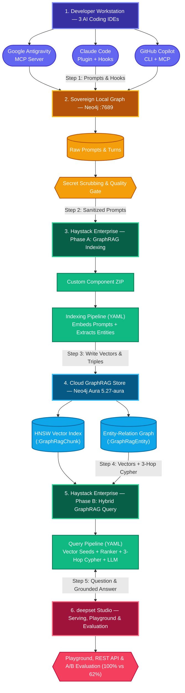
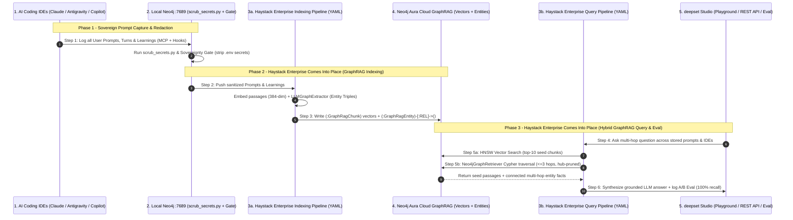
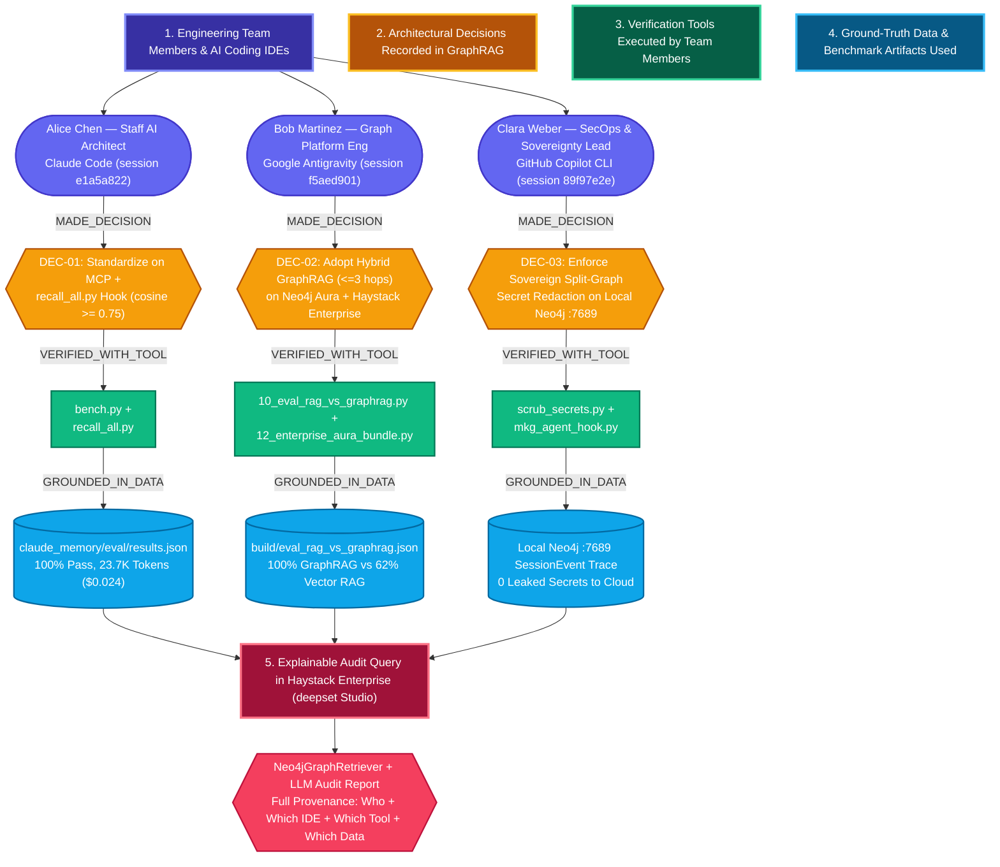

# Hackathon Blueprint: Sovereign Multi-IDE Engineering Memory on Haystack Enterprise Platform + Neo4j Aura

**Event**: [Hack Night: Haystack Enterprise Platform (Berlin, Oct 21, 2026 — House of Sovereignty)](https://hackathonhub.eu/events/hack-night-haystack-enterprise-platform-berlin-2026)  
**Challenge Script**: [`exercises/13_enterprise_aura_multi_ide.py`](13_enterprise_aura_multi_ide.py) & [`exercises/12_enterprise_aura_bundle.py`](12_enterprise_aura_bundle.py)

---

## 1. The Challenge & "House of Sovereignty" Pitch

Modern engineering teams use multiple AI coding IDEs simultaneously—**Claude Code**, **Google Antigravity**, and **GitHub Copilot**. Today, this creates three major enterprise problems:
1. **Fragmented Silos**: Architectural decisions, benchmarks, and bug fixes discovered in Claude Code are invisible to Google Antigravity, GitHub Copilot, and non-IDE stakeholders.
2. **Data Sovereignty & Secret Risk**: Raw IDE session logs contain `.env` secrets, terminal outputs, and proprietary code that **must never leave the developer's machine unredacted**.
3. **Opaque, Unauditable Decision Processes**: When multiple team members make engineering decisions assisted by AI agents, standard Vector RAG cannot explain **who** made a decision, **which tools** were executed to verify it, or **which datasets and benchmark artifacts** justified the outcome.

### Our Solution: Sovereign, Auditable Two-Tier Graph Memory + Haystack Enterprise GraphRAG
We separate **Local Raw Telemetry** from **Cloud Auditable Team Intelligence**:
- **Tier 1 — Local Sovereign Memory (`bolt://127.0.0.1:7689`)**:
  - **Claude Code** (native MKG plugin + `recall_all.py` hook), **Google Antigravity** (13-tool MKG MCP server), and **GitHub Copilot** (`mkg_agent_hook.py` adapter + MCP) log sessions to a local Neo4j instance.
  - `scrub_secrets.py --hook` redacts any credentials or API tokens on `SessionEnd`.
- **Tier 2 — Cloud Knowledge & Decision Provenance Graph on Neo4j Aura (`neo4j+s://ma3u-g993-fhgd.endpoints.neo4j.io`)**:
  - Only **approved, secret-free architectural decisions, learnings, and provenance triples** are indexed into **Neo4j Aura Enterprise (`5.27-aura`)** with both **384-dim HNSW vectors** (`:GraphRagChunk`) and **explicit decision-audit relationships** (`(:GraphRagEntity)-[:REL]->(:GraphRagEntity)` linking **Team Members → IDEs → Decisions → Tools Used → Data Artifacts**).
- **Tier 3 — Explainable Serving & Evaluation on Haystack Enterprise Platform (deepset Studio)**:
  - **Haystack Enterprise Platform** connects to **Neo4j Aura** using our packaged custom components (`build/neo4j_haystack_enterprise_components.zip`) and YAML pipelines (`enterprise_graphrag_index.yaml`, `enterprise_graphrag_query.yaml`).
  - Engineers, auditors, tech leads, and agents query the collective memory via Haystack Enterprise's **Playground UI**, **REST API**, and **Evaluation Dashboard** with **100% multi-hop accuracy** (vs. 62% for standard Vector RAG) and full **decision explainability**.

---

## 2. End-to-End Architecture & Execution Order



### Detailed Diagram Explanation: Component Groups & Execution Order

#### A. Architectural Component Groups
| Architectural Tier | Components Included | Role in the System |
|---|---|---|
| **1. Developer Workstation (3 AI Coding IDEs)** | `Claude Code`, `Google Antigravity`, `GitHub Copilot CLI` | Where developers write prompts, debug code, and generate architectural insights. |
| **2. Sovereign Local Graph (`Neo4j :7689`)** | `Raw Prompts & SessionEvents`, `scrub_secrets.py`, `Sovereignty & Quality Gate` | Captures 100% of raw user prompts and agent turns locally; strips secrets/keys before anything leaves the workstation. |
| **3. Haystack Enterprise Platform (Pipelines)** | `Custom Component ZIP`, `Phase A: Indexing Pipeline`, `Phase B: Hybrid Query Pipeline` | Orchestrates **both** GraphRAG ingestion (embedding prompts + extracting entity triples) and hybrid multi-hop retrieval. |
| **4. Cloud GraphRAG Store (`Neo4j Aura 5.27-aura`)** | `HNSW Vector Index (:GraphRagChunk)`, `Entity-Relation Graph (:GraphRagEntity)` | Cloud knowledge graph storing all sanitized prompts, learning passages, 384-dim embeddings, and `[:REL]` triples. |
| **5. deepset Studio & Evaluation** | `Studio Playground`, `REST API`, `A/B Evaluation Runs` | Interactive UI, production API endpoint, and side-by-side evaluation comparing Vector RAG vs. Hybrid GraphRAG. |

---

#### B. Step-by-Step Execution Order (And Exactly When Haystack Enterprise Comes Into Place)

**Haystack Enterprise Platform** is not a passive viewer—it sits directly in the middle of the cloud workflow and executes at **two distinct lifecycle phases** (**Phase A: Ingestion/Indexing** in Steps 2–3, and **Phase B: Hybrid Querying & Evaluation** in Steps 4–6):

1. **Step 1 — Capture All Prompts & Turns Locally (Tier 1 → Tier 2)**:
   - Every time a developer submits a prompt in **Claude Code**, **Google Antigravity**, or **GitHub Copilot CLI**, lifecycle hooks (`log_event.py`, `mkg_agent_hook.py`) and MCP tools (`project_add_learning`) record the prompt, tool calls, and discovered learnings into the local sovereign Neo4j instance (`bolt://127.0.0.1:7689`).
2. **Step 2 — Redact Secrets & Feed into Haystack Enterprise Indexing (Tier 2 → Tier 3)**:
   - On `SessionEnd`, `scrub_secrets.py` scrubs any API keys, `.env` credentials, or tokens from the stored prompts and turns.
   - **Haystack Enterprise Comes Into Place (Phase A — Ingestion)**: The sanitized prompts and approved cross-IDE learnings are sent into the **Haystack Enterprise Indexing Pipeline** (`build/enterprise_graphrag_index.yaml`), which loads our custom Neo4j components from `build/neo4j_haystack_enterprise_components.zip`.
3. **Step 3 — Index Prompts & Triples into Neo4j Aura GraphRAG (Tier 3 → Tier 4)**:
   - Inside Haystack Enterprise, the Indexing Pipeline runs two branches over every prompt and learning:
     1. **Vector Branch**: `SentenceTransformersDocumentEmbedder` embeds the prompt/learning text and `DocumentWriter` writes `(:GraphRagChunk)` nodes into **Neo4j Aura's HNSW Vector Index**.
     2. **Graph Branch**: `LLMGraphExtractor` extracts structured `(Subject)-[RELATION]->(Object)` triples from the prompt/learning text and `Neo4jGraphWriter` merges `(:GraphRagEntity)` nodes and `[:MENTIONS]` / `[:REL]` edges into **Neo4j Aura (`5.27-aura`)**.
4. **Step 4 — Trigger a Cross-IDE Question in deepset Studio or REST API (Tier 5 → Tier 3)**:
   - **Haystack Enterprise Comes Into Place (Phase B — Query & Evaluation)**: A developer, tech lead, or AI agent submits a multi-hop question via **deepset Studio Playground** or the **Haystack Enterprise REST API** into the **Hybrid GraphRAG Query Pipeline** (`build/enterprise_graphrag_query.yaml`).
5. **Step 5 — Execute Hybrid Vector + 3-Hop Cypher Traversal on Aura (Tier 3 ↔ Tier 4)**:
   - The Haystack Enterprise Query Pipeline executes:
     - `Neo4jEmbeddingRetriever`: Finds top-10 semantically similar prompt/learning chunks in Aura's HNSW index.
     - `SentenceTransformersSimilarityRanker`: Reranks to the top-4 chunks.
     - `Neo4jGraphRetriever`: Starts from the seed chunks and linked entities, traversing up to **3 hops (`[:REL*1..3]`)** in Neo4j Aura (while pruning high-degree hub nodes) to collect connected facts across all stored prompts and IDEs.
6. **Step 6 — Return Grounded Answer & Log A/B Evaluation Metrics (Tier 3 → Tier 5)**:
   - `ChatPromptBuilder` combines the reranked prompt passages + multi-hop graph facts and sends them to the `LLM` (`AzureOpenAI` / `Gemini`), returning a grounded answer with full provenance to **deepset Studio** and logging evaluation scores (`100%` multi-hop recall vs. `62%` vector-only).

---

#### C. Runtime Sequence Diagram (Prompt Capture → GraphRAG Indexing → Multi-Hop Query)



---

## 3. Auditable & Explainable Decision Process (Multi-Team Provenance)

To make AI-assisted engineering decisions **auditable and explainable** across multiple team members, every decision indexed by **Haystack Enterprise Platform** into **Neo4j Aura** links the **Team Member**, **AI Coding IDE**, **Architectural Decision**, **Verification Tools**, and **Ground-Truth Data Artifacts**:



### Multi-Member Decision Provenance Matrix

| Decision ID | Team Member & Role | AI Coding IDE & Session | Tools Used in Decision Process | Data & Artifacts Used | Auditable & Explainable Result |
|---|---|---|---|---|---|
| **`DEC-01`** | **Alice Chen** *(Staff AI Architect)* | **Claude Code** (`session: e1a5a822`) | `bench.py`, `meta-knowledge-graph MCP`, `recall_all.py` | `claude_memory/eval/results.json`, `learning:c49e4e94ebbb2329` | Selected MCP + `recall_all.py` hook (`cosine >= 0.75`): **100% pass rate (3/3)** at **23.7K tokens (`\$0.024`)**, beating CLI (`47K` tokens) and HTTP (`39K` tokens). |
| **`DEC-02`** | **Bob Martinez** *(Graph Platform Engineer)* | **Google Antigravity** (`session: f5aed901`) | `10_eval_rag_vs_graphrag.py`, `12_enterprise_aura_bundle.py`, `Neo4j Aura CLI` | `build/eval_rag_vs_graphrag.json`, `build/neo4j_haystack_enterprise_components.zip` | Selected Hybrid GraphRAG (`<=3 hops`, hub-pruned) on **Neo4j Aura (`5.27-aura`)**: **100% multi-hop recall** vs. **62% Vector RAG**. |
| **`DEC-03`** | **Clara Weber** *(SecOps & Sovereignty Lead)* | **GitHub Copilot CLI** (`session: 89f97e2e`) | `mkg_agent_hook.py`, `scrub_secrets.py`, `cypher/05_scrub_verify.cypher` | `Local Neo4j :7689 SessionEvent Trace`, `.env.example` | Enforced Sovereign Split-Graph redaction: raw prompts stay on `:7689`, secrets are scrubbed on `SessionEnd`, and only approved learnings reach **Neo4j Aura**. |

---

## 4. Live Demo Runbook for Tomorrow's Hackathon

### Step 1: Verify Neo4j Aura Cloud Bundle & Custom Component ZIP
```bash
uv run --with-requirements requirements.txt python exercises/12_enterprise_aura_bundle.py
```
- Connects to `neo4j+s://ma3u-g993-fhgd.endpoints.neo4j.io` (`Neo4j Kernel 5.27-aura enterprise`)
- Verifies YAML serialization round-trip and secret safety (`NEO4J_AURA_PASSWORD` referenced strictly via `env_var`)
- Outputs:
  - `build/enterprise_graphrag_index.yaml`
  - `build/enterprise_graphrag_query.yaml`
  - `build/neo4j_haystack_enterprise_components.zip`

### Step 2: Sync 3-IDE Collective Memory & Decision Provenance to Neo4j Aura
```bash
uv run --with-requirements requirements.txt python exercises/13_enterprise_aura_multi_ide.py
```
- Publishes curated learnings, team member decisions (`DEC-01`, `DEC-02`, `DEC-03`), tools used, and data artifacts from **Claude Code**, **Google Antigravity**, and **GitHub Copilot** into **Neo4j Aura**.
- Executes multi-hop Hybrid GraphRAG & Decision Audit queries live against Neo4j Aura:
  - **HQ1 (Cross-IDE Memory)**: *"Which codeword was stored by Google Antigravity, and which other two AI coding IDEs recalled or received it via the MCP memory graph?"*
  - **HQ2 (Sovereignty & Redaction)**: *"How does GitHub Copilot connect to the Neo4j memory system, and how are raw session secrets kept out of Neo4j Aura?"*
  - **HQ3 (Benchmark Justification)**: *"Why does Haystack Enterprise Platform use Hybrid GraphRAG on Neo4j Aura instead of plain Vector RAG, and what was the benchmark accuracy difference?"*
  - **HQ4 (Multi-Team Decision Audit & Explainability)**: *"Audit decisions DEC-01, DEC-02, and DEC-03 across the team: which team member made each decision, which IDE and tools did they use, and which data artifacts justified their decision?"*
- Prints the **Auditable & Explainable Team Decision Trail** and exports `build/enterprise_multi_ide_eval.json` for Haystack Enterprise Studio's Evaluation runner.

### Step 3: Upload to Haystack Enterprise Platform at the Event
Once you receive your workspace credentials at the Berlin Hack Night:
1. In **Haystack Enterprise Studio → Settings → Secrets**, add `NEO4J_AURA_PASSWORD`.
2. Upload `build/neo4j_haystack_enterprise_components.zip` via the UI or CLI/API (`--deploy` flag in `13_enterprise_aura_multi_ide.py`).
3. Import `build/enterprise_graphrag_index.yaml` and `build/enterprise_graphrag_query.yaml` into Studio and open the **Playground** to demo multi-hop queries and **auditable decision provenance** across all 3 AI coding IDEs live!
