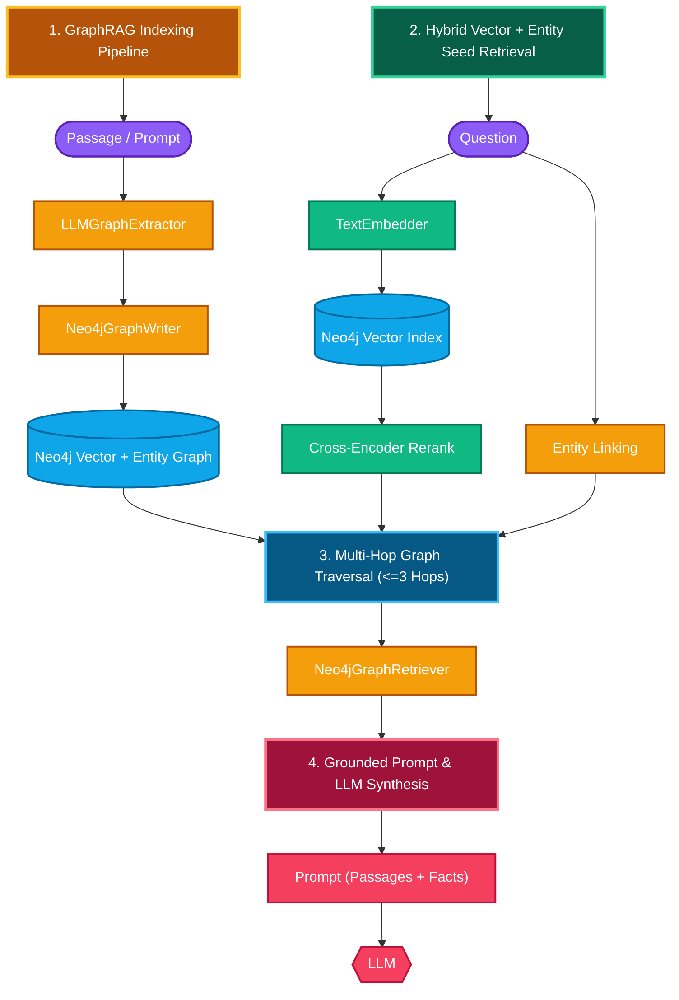

# Vector RAG vs GraphRAG on Neo4j, with Haystack

Exercises 07–10 build a custom Neo4j `DocumentStore`, a vector retriever, a GraphRAG pipeline,
and an evaluation that compares them. This page summarizes what differs, what we measured,
and why Haystack is a good host for GraphRAG.

## 1. The two approaches

**Vector RAG** (exercise 08): retrieve passages that *look like* the question.

```mermaid
flowchart LR
    H1["1. Input"] --> Q(["Question"])
    Q --> H2["2. Vector Retrieval & Reranking"]
    H2 --> E["TextEmbedder"] --> V[("Neo4j Vector Index")] --> R["Cross-Encoder Rerank"]
    R --> H3["3. LLM Generation"] --> P["ChatPromptBuilder"] --> L{{"LLM"}}

    style H1 fill:#4c1d95,stroke:#a78bfa,color:#ffffff,stroke-width:3px
    style Q fill:#8b5cf6,stroke:#5b21b6,color:#ffffff,stroke-width:2px

    style H2 fill:#065f46,stroke:#34d399,color:#ffffff,stroke-width:3px
    style E fill:#10b981,stroke:#047857,color:#ffffff,stroke-width:2px
    style R fill:#10b981,stroke:#047857,color:#ffffff,stroke-width:2px

    style V fill:#0ea5e9,stroke:#0369a1,color:#ffffff,stroke-width:2px

    style H3 fill:#9f1239,stroke:#fb7185,color:#ffffff,stroke-width:3px
    style P fill:#f43f5e,stroke:#be123c,color:#ffffff,stroke-width:2px
    style L fill:#f43f5e,stroke:#be123c,color:#ffffff,stroke-width:2px
```



**GraphRAG** (exercise 09): same seeds, plus *facts connected to* the question.



The only difference between the two query pipelines is one extra component
(`Neo4jGraphRetriever`) between the ranker and the prompt. Same corpus, embedding model,
reranker, prompt template and LLM.

### Diagram Explanation: Component Groups & Execution Order
- **Inputs**: Passages/prompts ingested during indexing (`Passage`) and user queries at runtime (`Question`).
- **Vector Seed & Reranking**: `TextEmbedder` and `Cross-Encoder Rerank (top 4)` compute query vectors and rerank the top candidate passages.
- **Graph Extraction & Multi-Hop Traversal**: At **Indexing time**, `LLMGraphExtractor` + `Neo4jGraphWriter` extract `(Entity)-[REL]->(Entity)` triples from every passage/prompt. At **Query time**, `Entity Linking` + `Neo4jGraphRetriever` traverse up to 3 hops (`<=3 hops`, hubs pruned, `<=50` facts) from the vector seed chunks.
- **Neo4j Vector + Knowledge Graph**: Stores both the HNSW vector index (`(:GraphRagChunk)`) and the entity-relationship graph (`(:GraphRagEntity)-[:REL]->(:GraphRagEntity)`) in Neo4j / Neo4j Aura.
- **Synthesis & LLM Generation**: `Prompt (Passages + Facts)` merges the reranked passages with multi-hop graph facts and passes them to the `LLM`.

## 2. Why vector RAG fails on multi-hop questions

Question m2: *"In which office does the manager of Project Halcyon's lead work?"*

The answer needs three passages:

| Passage | Mentions Halcyon? | Looks like the question? |
|---|---|---|
| "Project Halcyon … is led by Ines Varga." | yes | yes |
| "Ines Varga … reports directly to Tomas Brandt." | no | weakly |
| "Tomas Brandt works from the Lisbon office …" | no | no |

Similarity search ranks passages by resemblance to the question, so the second and third links
score low and get cut. The LLM then correctly says "I don't know". Giving it more passages
(top 8 instead of 4) helps only a little, because the missing links still rank below unrelated
passages that share words with the question.

The graph has no such problem: starting from the entity `Project Halcyon`, it walks
`LED_BY → Ines Varga → REPORTS_TO → Tomas Brandt → WORKS_FROM → Lisbon office`, whatever
the passages look like.

## 3. Measured results

Setup: `data/graphrag_corpus.txt` (24 passages about a fictional company, so the LLM cannot
answer from memory), `data/graphrag_eval.json` (22 questions: 8 single-hop, 14 multi-hop),
Azure OpenAI `gpt-5-mini` for answers and as judge, 3 runs per question.

| Variant | Overall | Single-hop (8) | Multi-hop (14) | Answer string in context | Avg context tokens |
|---|---|---|---|---|---|
| `vector` (top 10 → rerank top 4) | 62% | 100% | 40% | 82% | 195 |
| `vector_k8` (top 8, no rerank) | 68% | 100% | 50% | 82% | 351 |
| `graphrag` (`vector` + graph facts) | **100%** | 100% | **100%** | 100% | 777 |

Observations:

- **Single-hop questions are solved by every variant.** GraphRAG adds nothing there.
- **Vector RAG fails safely.** Its wrong answers are "I don't know" (plus one partial list),
  not hallucinations. The problem is recall, not the LLM.
- **More context alone is not the fix.** Doubling the passages moved multi-hop from 40% to 50%.
- **GraphRAG costs more.** About 4× the prompt tokens, plus one LLM extraction call per passage
  at indexing time (24 calls, ~1 minute here).

### Read these numbers with care

- The GraphRAG settings (3 hops, 50 facts, hub pruning) were tuned while looking at questions
  from this eval set. A fair result needs a held-out question set.
- The graph is small (≈100 entities, ≈109 relations). 50 facts are ~46% of the whole graph,
  so the retriever barely has to be selective. On a real corpus the fact budget bites harder
  and extraction is noisier.
- Corpus and questions were written together to exercise multi-hop reasoning. This shows
  where GraphRAG is strong; it is not a neutral benchmark.
- 22 questions: one question is worth ~4.5 percentage points.
- "Answer string in context" only checks that the answer appears in the prompt somewhere
  (e.g. "Lisbon" also appears in an unrelated office passage), so it overstates vector recall.

## 4. When to use which

| Situation | Use |
|---|---|
| Questions answered by one passage (FAQ, docs lookup, "what is X") | Vector RAG (+ reranker). Cheaper, simpler. |
| Questions that chain relations: org charts, supply chains, dependencies, ownership, citations | GraphRAG |
| "Which X have property Y" aggregations across many documents | GraphRAG (or metadata filters if the property is structured) |
| Data that already is a graph (CMDB, knowledge graph, lineage) | GraphRAG, skip LLM extraction and query the graph directly |
| Mixed workloads | Both: vector seeds + graph expansion, exactly what exercise 09 does |

Costs to budget for GraphRAG: LLM extraction per chunk at ingest (and again on re-index),
entity normalization ("Lumen DB" vs "the Lumen DB"), a graph schema to maintain,
and larger prompts at query time.

## 5. Why GraphRAG and Haystack together

GraphRAG is a retrieval *strategy*, not an application. You still need ingestion, chunking,
embedding, reranking, prompting, LLM provider handling, evaluation and deployment. Haystack
provides all of that, and the graph parts slot in as ordinary components.

1. **GraphRAG is three components, not a new framework.** `LLMGraphExtractor`,
   `Neo4jGraphWriter` and `Neo4jGraphRetriever` are plain `@component` classes with typed inputs
   and outputs. They plug into the same pipelines as Haystack's converters, splitters, embedders
   and rankers. Nothing else changed to add GraphRAG to the vector pipeline.
2. **Vector and graph retrieval combine naturally.** The best result came from *vector seeds +
   graph expansion*. In a pipeline that is just one more `connect()`: the ranker's documents
   feed the graph retriever, and both passages and facts feed the prompt. Pure graph tools tend
   to treat this hybrid as an afterthought.
3. **Fair A/B testing comes for free.** All three variants are built by one function
   (`graphrag_pipelines.build_query`) and share the prompt template, LLM and ranker, so the eval
   measures the retrieval strategy and nothing else. The eval itself runs the same pipelines with
   the LLM step removed.
4. **The `DocumentStore` protocol makes Neo4j a first-class store.** Because
   `Neo4jDocumentStore` passes Haystack's own conformance suite (`DocumentStoreBaseTests`),
   standard components like `DocumentWriter` and `FilterRetriever` work on it unchanged. One
   Neo4j database holds the chunks, their embeddings (native vector index) and the entity graph.
5. **Provider independence.** The LLM comes from one factory (`llm.py`). Extraction, answering
   and judging switched to Azure OpenAI without touching any GraphRAG code; switching to
   OpenAI, Anthropic or a local model is the same one-line change.
6. **Path to production.** Pipelines serialize to YAML (`pipeline.dumps()`, with
   `allowed_modules` for our custom modules) and can be served via Hayhooks or FastAPI
   (Challenge E). The graph components serialize like any other component.
7. **Stepwise adoption.** Start with vector RAG, measure, and add the graph only where
   multi-hop questions fail. The eval in exercise 10 is the tool for that decision.

## 6. Files

| File | Purpose |
|---|---|
| `neo4j_document_store.py` | `DocumentStore` on Neo4j: filters → Cypher, vector index, `embedding_retrieval` |
| `neo4j_embedding_retriever.py` | `Neo4jEmbeddingRetriever` component |
| `neo4j_graph.py` | `LLMGraphExtractor`, `Neo4jGraphWriter`, `Neo4jGraphRetriever` |
| `graphrag_pipelines.py` | Indexing pipeline + the three query variants |
| `09_graphrag.py` | Build the graph, side-by-side demo |
| `10_eval_rag_vs_graphrag.py` | Accuracy evaluation, writes `results/graphrag_eval_results.json` |
| `test_neo4j_document_store.py` | Haystack conformance tests + retriever tests |

```bash
python 09_graphrag.py --reset          # build graph (~25 LLM calls)
python 10_eval_rag_vs_graphrag.py --runs 3
```

Explore the graph in Neo4j Browser:

```cypher
MATCH p=(:GraphRagEntity {name: "Project Halcyon"})-[:REL*1..3]-() RETURN p
```

### Azure OpenAI throughput

The eval makes ~400 LLM calls. With the deployment at 50K tokens/min and 50 requests/min it hit
`429 rate_limit_exceeded` repeatedly. At capacity 1,000 (1M tokens/min, 1,000 requests/min,
DataZoneStandard) and `--workers 8`, the full 3-run eval takes about 3 minutes. On rate limits,
lower `--workers`.
